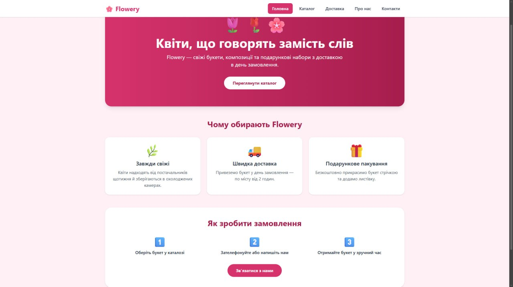
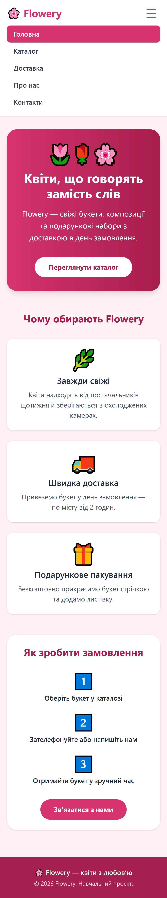
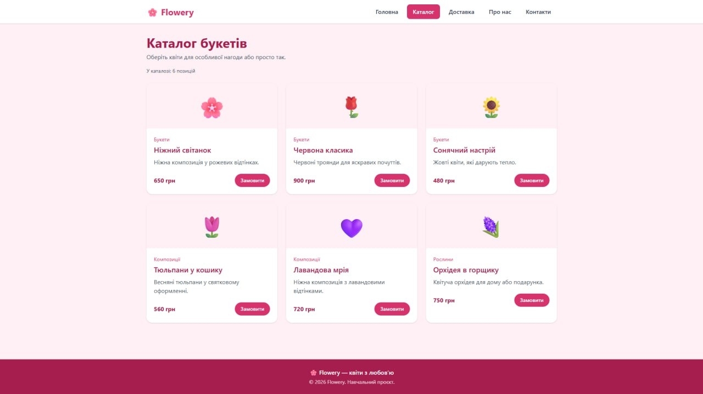
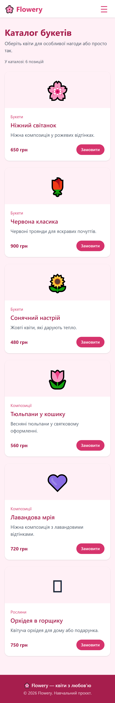
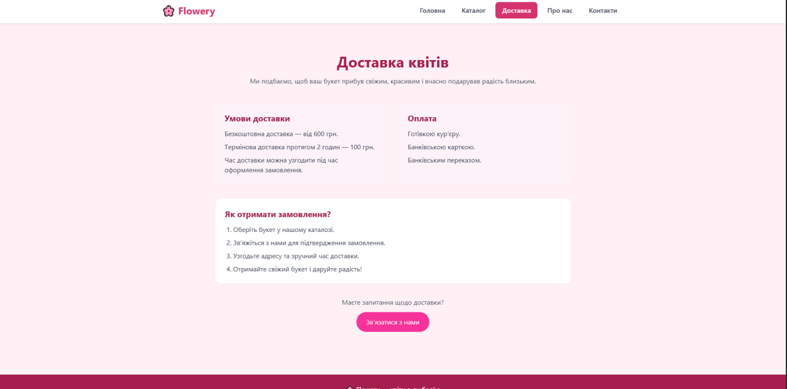
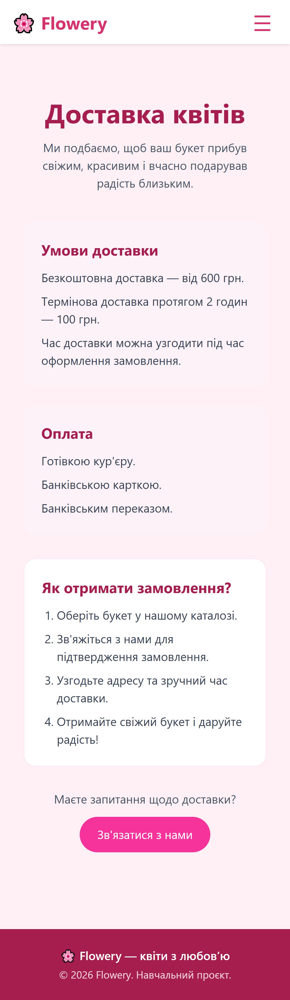
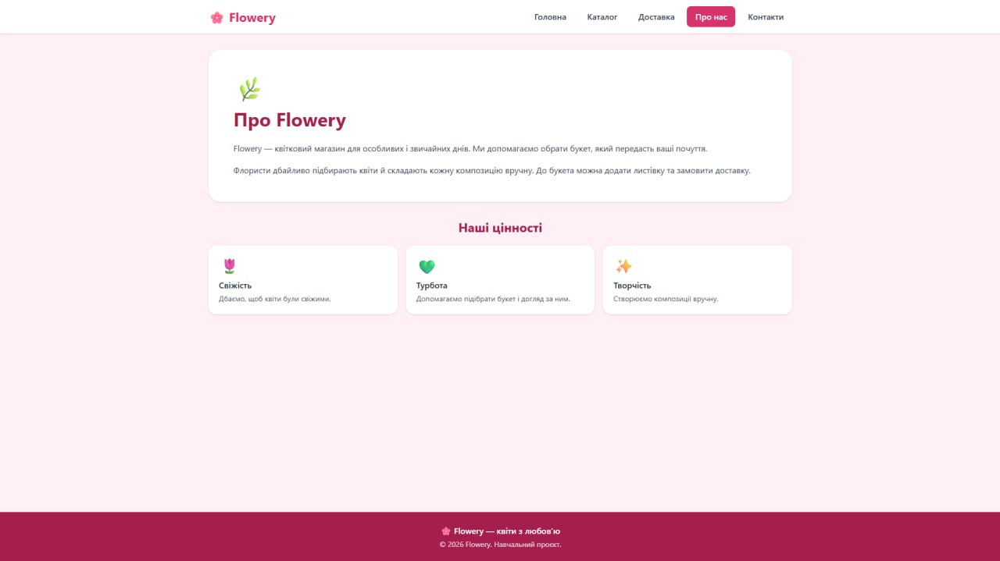
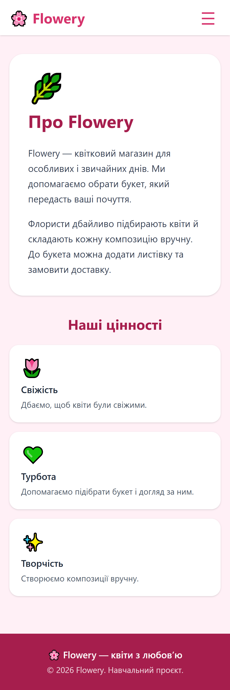
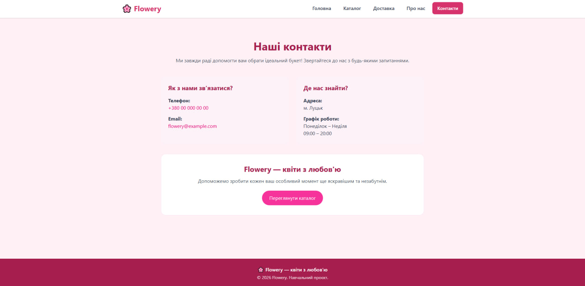
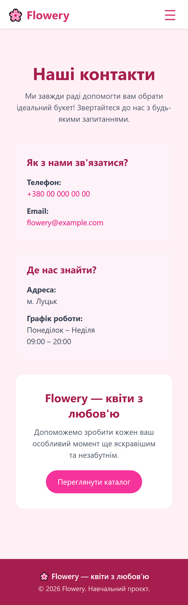

# Звіт з лабораторної роботи № 03
## Розробка базового вебпроєкту

**ПІБ:** Полезнюк Аліна Вікторівна  
**Група:** ІПЗ-21

**Склад команди:**
1. Міщук Дарія Олександрівна — `Daria09876564321`
2. Стрілець Надія Андріївна — `GinaWQ`

**Тема проєкту:** вебсайт квіткового магазину «Flowery»

**Репозиторій:** https://github.com/GinaWQ/Flowery

## 1. Особистий внесок у командну роботу

- оформила сторінку `contacts.html`, на якій розмістила контактну інформацію магазину, адресу, графік роботи та інформацію для покупців.
- Оформила сторінку `delivery.html`, де описала умови, терміни та способи оплати доставки.
- Виправила помилку наслідування шаблону в `contacts.html`, замінивши неправильне посилання на `base.html`.
- Перевірила роботу створених сторінок у Flask-застосунку.

**Мій коміт:**  
[Add delivery and contacts pages](https://github.com/GinaWQ/Flowery/commit/8fbd608)

## 2. Скріншоти

### Головна сторінка

Десктопний вигляд:

Мобільний вигляд:

### Каталог

Десктопний вигляд:

Мобільний вигляд:

### Доставка

Десктопний вигляд:

Мобільний вигляд:

### Про нас

Десктопний вигляд:

Мобільний вигляд:

### Контакти

Десктопний вигляд:

Мобільний вигляд:

## 3. Труднощі та їх вирішення

1. Виникла проблема з доступом до GitHub. Вирішила її після прийняття запрошення до репозиторію та авторизації.
2. У файлі `contacts.html` було неправильне наслідування шаблону. Виправила його, вказавши `base.html`.

## 4. Висновки

Під час лабораторної роботи закріпила навички створення вебсторінок за допомогою Flask і Jinja2. Також отримала досвід командної роботи з Git і GitHub та об'єднання змін у спільному проєкті.